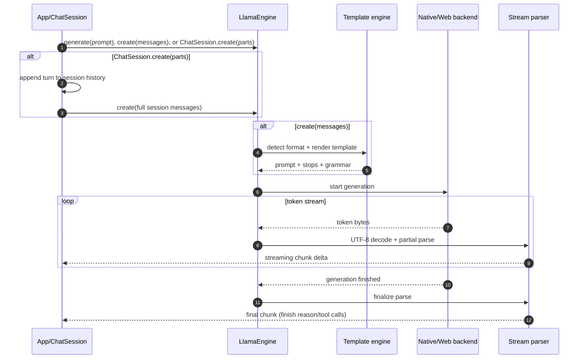

`llamadart` exposes three generation entry points:

- `engine.generate(prompt)` for raw prompt strings.
- `engine.create(messages)` for stateless, chat-template aware completions.
- `ChatSession.create(parts)` for stateful, multi-turn chat with automatic
  history management.

## Choosing the right API

| API | Template-aware? | Keeps history? | Use when |
| --- | --- | --- | --- |
| `engine.generate(prompt)` | No | No | You already rendered the final raw prompt, or you are benchmarking, testing prefix-cache/state flows, or doing other low-level runtime work. |
| `engine.create(messages)` | Yes | No | You have the complete `List<LlamaChatMessage>` for each request, such as an OpenAI-compatible server, a one-shot completion, or an app that owns its transcript. |
| `ChatSession.create(parts)` | Yes | Yes | You are building a multi-turn chat UI/CLI and want the SDK to append user/assistant turns, apply the system prompt, and trim history as the context grows. |

For one-shot instructions, prefer `engine.create(...)`: it applies the chat
template without session state, and a follow-up turn sees only the messages you
pass again. For chat apps, prefer `ChatSession` unless your app already stores
the transcript. `session.addMessage(...)` restores history or inserts tool
results, and `session.reset()` starts over. See
[First Chat Session](../getting-started/first-chat-session) for a multi-turn
example.

`create` and `chatTemplate` reject tool-role image/audio content with
`LlamaUnsupportedException` before rendering or backend dispatch, including
media alongside `LlamaToolResultContent` under another role. Session context
budgeting applies the same check to history. Tool images go in
`LlamaToolResultContent.content` instead, where the engine reports them; see
[tool-result media](./tool-calling#tool-result-media).

## Generation pipeline (visual)



## Low-level generation API

```dart
await for (final token in engine.generate(
  'List two advantages of local LLM inference.',
  params: const GenerationParams(maxTokens: 64, temp: 0.4),
)) {
  print(token);
}
```

## Chat completion API

```dart
final messages = [
  LlamaChatMessage.fromText(
    role: LlamaChatRole.user,
    text: 'Explain top-p in plain language.',
  ),
];

await for (final chunk in engine.create(
  messages,
  params: const GenerationParams(maxTokens: 128, topP: 0.95),
)) {
  if (chunk.thinking.isNotEmpty) stdout.write('[thinking] ${chunk.thinking}');
  stdout.write(chunk.text);
}
```

`chunk.text` and `chunk.thinking` are the first choice's answer and reasoning
deltas, or empty strings. `chunk.toolCalls` lists its tool-call deltas, and
`chunk.finishReason` is a `LlamaFinishReason` (`stop`, `length` or
`toolCalls`) on the final chunk and null on every other one. The raw
OpenAI-style fields stay available under `chunk.choices`.

### Collect a whole reply

When you do not need to render tokens as they arrive, collect the stream:

```dart
// Just the answer text.
final answer = await engine.create(messages).text();

// Only the non-empty text deltas, for a sink that takes strings.
await engine.create(messages).textDeltas().forEach(stdout.write);

// Text, reasoning, assembled tool calls, finish reason and usage.
final completion = await engine.create(messages).collect();
if (completion.finishReason == LlamaFinishReason.length) {
  print('Reply was cut off at maxTokens.');
}
messages.add(completion.message); // Assistant turn for the next request.
```

`engine.complete(messages, ...)` is `engine.create(messages, ...).collect()`,
and `session.send('...')` sends one text turn through a `ChatSession` and
collects the reply. `completion.message` keeps the whitespace the model ended
the reply with; `ChatSession` stores the turn without it, so `trimRight()` the
text of a turn you keep yourself if the next prompt should not carry it.

`finishReason` does not tell you that a generation was cancelled. On every
backend, native and Web, a stream stopped by `engine.cancelGeneration()`,
before or during generation, usually still ends with `LlamaFinishReason.stop`
and whatever text it produced. `ChatSession` instead throws
`LlamaStateException` and rolls back its turn when cancelled before any reply
content, including through `createStructuredJson`. Track cancels in the code
that issues them, or read `LlamaOperationResult.cancelled` from an
[operation observer](#observing-operations).

`chunk.model` is the last path segment of the source the model was loaded
from, such as `qwen.gguf`: a local path's file name, or the last segment of a
URL path without its query or fragment. A local file name is reported as
written, `%` included. It is `llama_model` when that segment could carry more
than a file name, and for `data:` and `blob:` URLs. It leaves
out directories and hosts, but not the segment itself: a URL whose last
segment is a token reports that token, unless it repeats the URL's userinfo
credential, which reports `llama_model`. An OpenAI-compatible server that
exposes its own model id should set that id on its responses instead.

## Token usage and timings

On native llama.cpp, and on WebGPU with bridge assets `v0.1.54+`, the final
`create` chunk carries the request's usage whenever the backend reports it.
The backend can report none, for example for a request cancelled while it is
queued. Usage is null on LiteRT-LM, on older bridge assets and on every
earlier chunk. On WebGPU, `completionTokens` can include tokens generated after
a stop sequence, before the stop reached the bridge.

```dart
final usage = (await engine.complete(messages)).usage;
if (usage != null) {
  print('prompt ${usage.promptTokens} '
      '(cached ${usage.cachedPromptTokens}), '
      'completion ${usage.completionTokens}, '
      'first token ${usage.timeToFirstToken}, total ${usage.duration}');
}
```

The backend times `timeToFirstToken` and `duration` from when it starts the
request. They exclude template rendering and time spent queued behind another
request, and `timeToFirstToken` excludes stream batching.

## Observing operations

Pass observers to `LlamaEngine` to trace, measure or log its work. An observer
sees chat completions (`create`, `createStructuredJson` and
`ChatSession.create`), `generate`, `embed`, `embedBatch` and model loads.

```dart
final class TimingObserver extends LlamaEngineObserver {
  @override
  LlamaOperationObserver? onStart(LlamaOperation operation) {
    final name = switch (operation) {
      LlamaChatOperation() => 'chat',
      LlamaTextCompletionOperation() => 'text_completion',
      LlamaEmbeddingsOperation() => 'embeddings',
      LlamaModelLoadOperation() => 'model_load',
      _ => 'other',
    };
    return _Timing('$name ${operation.model}', Stopwatch()..start());
  }
}

final class _Timing extends LlamaOperationObserver {
  _Timing(this.name, this.watch);

  final String name;
  final Stopwatch watch;

  @override
  void onEnd(LlamaOperationResult result) {
    print('$name: ${watch.elapsed}, finish ${result.finishReason}, '
        'tokens ${result.usage?.totalTokens}');
  }
}

final engine = LlamaEngine(LlamaBackend(), observers: [TimingObserver()]);
```

- A `create` or `generate` operation starts when its stream is listened to;
  the others start when their method is called. Every callback runs in the
  zone that called the engine method, so a tracer can read its parent context
  there.
- `onChunk` receives each `create` chunk and `onText` each `generate` piece.
- `onEnd` runs once, with the error, the cancel, or the finish reason and
  usage. Usage is reported where the final `create` chunk carries it. A chat
  subscription cancelled after the final chunk ends completed, unless
  `cancelGeneration` stopped it first.
- `LlamaOperation.model` is the model's `general.name` metadata, or else the
  last segment of the path or URL it was loaded from. It is null when that
  segment is empty or contains one of `/ \ ? # @ ; & =`, so the segment is
  never a directory path, URL query, fragment or userinfo, and for `data:`
  and `blob:` URLs. On the built-in
  backends, `runtime` is `LlamaRuntime.llamaCpp` or `LlamaRuntime.liteRtLm`
  for operations after a model load, and null for the load itself.
- Operations carry copies of the prompts and messages. Record them only when
  your users opt in.
- Extend the observer classes rather than implementing them, and give a
  `switch` over operations a default case: later versions may add callbacks
  and operation types.
- An exception an observer throws is reported to the library logger as a
  warning and never reaches the caller. Without observers the engine does no
  observation work.

For a runnable observer-to-OpenTelemetry adapter and Langfuse/Grafana recipes,
see [Observability](./observability).

## Thinking budget (native llama.cpp)

For GGUF models with a thinking channel, `ThinkingBudget` maps to llama.cpp's
reasoning-budget sampler. It counts generated tokens inside each reasoning
block independently of `maxTokens`, which remains the cap for the entire
completion.

```dart
await for (final chunk in engine.create(
  messages,
  enableThinking: true,
  params: const GenerationParams(
    maxTokens: 512,
    thinkingBudget: ThinkingBudget(maxTokens: 128),
  ),
)) {
  // Render chunk.thinking and chunk.text independently.
}
```

`engine.create(...)` fills the start and end delimiters from recognized chat
templates. Raw `engine.generate(...)` calls must provide both delimiters in
`ThinkingBudget`. A budget of `0` immediately forces the end delimiter. This
is supported by native llama.cpp text generation only; LiteRT-LM and WebGPU
reject it explicitly, and it cannot be combined with speculative decoding.

## Structured JSON output

Use `LlamaStructuredOutput` when you want strict JSON plus final validation and
typed decoding. The helper builds the `responseFormat` map for grammar-capable
backends and validates the completed model output before returning your value.

```dart
class TicketClassification {
  TicketClassification({required this.priority, required this.category});

  final String priority;
  final String category;

  static TicketClassification fromJson(Map<String, dynamic> json) {
    return TicketClassification(
      priority: json['priority'] as String,
      category: json['category'] as String,
    );
  }
}

final output = LlamaStructuredOutput<TicketClassification>.jsonSchema(
  schema: const {
    'type': 'object',
    'properties': {
      'priority': {
        'type': 'string',
        'enum': ['low', 'medium', 'high'],
      },
      'category': {'type': 'string'},
    },
    'required': ['priority', 'category'],
    'additionalProperties': false,
  },
  decoder: TicketClassification.fromJson,
);

final classification = await engine.createStructuredJson(
  [
    LlamaChatMessage.fromText(
      role: LlamaChatRole.user,
      text: 'Classify this ticket: checkout fails with card declined.',
    ),
  ],
  output: output,
  params: const GenerationParams(maxTokens: 96, temp: 0),
);
```

Without the helper, pass `responseFormat: {'type': 'json_object'}` or
`{'type': 'json_schema', 'json_schema': {'schema': <JSON schema>}}` to
`engine.create(...)`; `json_schema` may also carry `name`, `description` and
`strict`, and `{'type': 'text'}` requests unconstrained text. A key whose
value is `null` counts as absent. Any other type or key, such as a misspelled
`json_shema` or `schma`, throws `LlamaUnsupportedException` before generation
on every backend.

Raw `json_schema` and typed helpers use the same validation before generation.
Unsupported assertions throw `LlamaUnsupportedException` with a schema path.
The unsupported keywords are `multipleOf`, `uniqueItems`, `contains`,
`minContains`, `maxContains`, `minProperties`, `maxProperties`,
`patternProperties`, `propertyNames`, `dependentRequired`, `dependentSchemas`,
`dependencies`, `not`, `if`, `then`, `else`, `unevaluatedItems`,
`unevaluatedProperties`, `additionalItems`, `$dynamicRef` and `$recursiveRef`.
The trivial assertions `uniqueItems: false`, `minProperties: 0` and integer
`multipleOf: 1` are accepted. Numeric bounds require explicit `type: integer`;
supported formats are `uuid`, `uuid1`–`uuid5`, `date`, `time`, and `date-time`.
UUID aliases enforce the same lexical shape as `uuid`, including uppercase hex,
without checking the version nibble. Other formats fail explicitly.

Validation also rejects assertion siblings shadowed by `$ref`, `anyOf`/`oneOf`,
or `const`/`enum` (except compatible literal `type`); pattern or format plus
length bounds; pattern plus format; and `prefixItems` plus `items`.
`required` names declared properties only. Length/item bounds must be integers
from 0 to 2000, inclusive. Both `prefixItems` and draft-07 `items: [...]` generate
fixed tuples: compatible bounds are accepted (`minItems` ≤ tuple length,
`maxItems` ≥ tuple length), while the grammar and typed parser require every item.
Integer bounds round fractional endpoints as in llama.cpp v0.7.0, must fit the
exact VM/Web range (absolute value at most 9007199254740991), and cannot have a
weaker inclusive bound shadow a stronger exclusive bound. One-sided positive
minima and negative maxima containing a nonfinal zero digit are rejected because
upstream loses suffix padding (`minimum: 100` admits `10`). At 16 digits, only
absolute endpoints matching `111111111111111[0-9]` are supported; others emit inverted
repetition bounds. Two-sided bounds are unaffected. One-sided negative maxima,
including Pydantic `NegativeInt`, reject leading-zero JSON integers; this corrects
an upstream v0.7.0 grammar defect.

`allOf` supports additive object-property merges and nonempty enum intersections,
including local references. Object merges make all merged properties required
in the grammar and emit a closed object, matching upstream. They ignore
annotation-only components such as `{"description": "..."}`, as upstream does;
such a component is rejected beside an enum intersection, where upstream would
drop the enum. An explicit outer
`type` must be `object`, or `string` for string enum intersections. Primitive
intersections, nested/union components, duplicate merged property names,
constrained additional properties (except a single closed object) and assertion
siblings are rejected because
upstream's merge does not enforce them.

Schema JSON nesting is limited to 128 containers, including annotation values.
Cycles and non-JSON values throw `LlamaArgumentException`; deep or malformed
schemas, constraints in the wrong context, conflicting bounds and unresolved or
external references throw `LlamaUnsupportedException`. References must target
schema positions, never annotation/extension payloads. On grammar-capable
backends a grammar llama.cpp would refuse to load also fails before generation.

For live rendering, keep the stream returned by
`engine.create(..., responseFormat: output.responseFormat)` and finalize it with
`await stream.parseStructuredJson(output)`. Validation is a final-output step
because partial stream chunks are often not valid JSON yet.

Supported schema features match the built-in JSON-schema-to-GBNF subset:
primitive types, objects with `properties`, `required`, and
`additionalProperties`, arrays with `items` or fixed tuples,
`enum`/`const`, local `$ref`, `anyOf`, `oneOf`, supported `allOf`, compiled
`pattern`, integer bounds, the string formats above, `minLength`,
`maxLength`, `minItems`, and `maxItems`. Arrays with bounds but no `items`
accept any JSON element. Unsupported schemas fail before
generation. Annotations (`discriminator`, content metadata, `example`/`examples`, `$anchor`,
`$id`, `$schema`, `$comment`, `deprecated`, `readOnly`, `writeOnly`, `title`,
`description`, `default`) and unknown vocabulary, including `x-*` extensions,
are preserved and ignored as constraints. Only schema positions are traversed;
unused `$defs`/`definitions` entries are ignored and validated only when referenced.
Formats use the upstream lexical rules, including month/day ranges and a
required timezone with optional three-digit fractional seconds; they do not
check calendar validity. Nonempty untyped
annotation-only schemas accept any JSON value; `{}` retains its object grammar.
Patterns must be anchored `^...$` sequences of safe literals, positive character
classes/ranges and groups, with group alternation and repetition counts up to
1024; unsupported regex constructs are rejected. Backends without
grammar constraints still fail early for strict output unless they expose a
separate admitted JSON Schema provider. Native LiteRT-LM has that bounded path
on macOS arm64 CPU with canonical Qwen3 text models; LiteRT-LM Web does not.

For native LiteRT-LM, pass `enableThinking: false`. The native subset accepts
`json_object` and object schemas with scalar properties, `required`, scalar
`enum`/`const`, and boolean `additionalProperties`. Nested schemas, arrays,
references, unions, patterns, formats and bounds are rejected before generation,
as are tools, media, custom templates, speculation and caller stop sequences.
`await engine.capabilities` admits the actual provider and may initialize the
loaded model; it reports structured output independently of GBNF support.
Model-backed qualification covers the corrected Qwen3-0.6B CPU artifact (SHA-256
`c5f39b4191926786c3e6668b62af4d6eb15248dfc7a5348252a9b406f33f2108`); other
canonical Qwen3 models still need their own qualification.
A token/context cutoff can still leave partial JSON; final helper validation
remains necessary.

`ChatSession` takes the same `responseFormat` on `session.create(...)` and has
`session.createStructuredJson(parts, output: output)` for multi-turn structured
output; the JSON reply is kept in the session history like any other turn.
An unrecognised format, or a strict one on a backend without grammar
constraints, throws before the user message joins the history. A request that
fails or is cancelled before any reply content takes back its own user message
(and any turns its context trimming dropped, if the history is otherwise
unchanged), so a retry does not repeat the user turn. Empty terminal chunks do
not count as reply content. Generation cancellation before content throws
`LlamaStateException`; structured JSON helpers preserve that error instead of
trying to parse an empty reply. After content, the partial reply is kept as
an assistant turn, unless the session was reset or its initiating message
was removed. A model change during draft-model resolution throws
`LlamaStateException` and rolls back the turn. A history edit while the
context is being prepared also throws `LlamaStateException`, preserving the
changed conversation instead of trimming it with stale offsets.

## `create(...)` flow at a glance

1. Build your `List<LlamaChatMessage>`.
2. `engine.create(...)` runs template rendering/parity logic.
3. Effective stop sequences and grammar are applied to generation params.
4. Backend token bytes are decoded and emitted as streaming chunks.
5. Final parse resolves tool calls and stop reason.

## Cancellation

```dart
engine.cancelGeneration();
```

This cancels every `create`, `generate` and `ChatSession.create` stream that has
been listened to, including one still rendering its template or checking its
input: that stream ends without generating. On native llama.cpp and
LiteRT-LM the stream ends normally, and its final chunk's `finishReason` is
usually `stop`, so it does not mark the cancel. `ChatSession` throws
`LlamaStateException` if cancelled before reply content and rolls back the
turn; it keeps a partial reply only while its original turn remains in
history. On WebGPU, the cancel can
instead surface as a generation error on the stream. A stream listened to
after the call is not affected. How quickly a running generation stops
depends on the backend.

Cancelling a stream's subscription also sends the cancel to its backend at
once, even before the first token.

On native llama.cpp, a cancel during text prompt evaluation takes effect at the
next prompt micro-batch (`ModelParams.microBatchSize` tokens), or at the next
batch (`ModelParams.batchSize` tokens) with speculative decoding.

On native llama.cpp and on LiteRT-LM, native and Web, a generation started
while a cancelled one is still stopping waits for it to stop, then runs.
`cancelGeneration()` or disposing the engine ends a waiting generation without
running it. Starting one while another is running and not cancelled, or while
one is already waiting, throws `LlamaStateException`.

## Tokenization helpers

```dart
final tokens = await engine.tokenize('hello world');
final text = await engine.detokenize(tokens);
final count = await engine.getTokenCount('hello world');
```

These helpers are useful for context budgeting and prompt diagnostics.

## Next-token scores

`engine.scoreNextToken(...)` evaluates a prompt and returns the
log-probabilities of the token that would follow it, without generating. Ask
for specific token ids with `candidates`, the most probable tokens with `topK`,
or both. Reading the probabilities of answer letters turns an
instruction-tuned model into a classifier:

```dart
final prompt = (await engine.chatTemplate([
  const LlamaChatMessage.fromText(
    role: LlamaChatRole.user,
    text: 'Is "remind me to call mom at 5" a (A) reminder or (B) search? '
        'Answer with the letter only.',
  ),
], enableThinking: false)).prompt;
final letters = [
  for (final letter in ['A', 'B'])
    (await engine.tokenize(letter, addSpecial: false)).single,
];

final scores = await engine.scoreNextToken(prompt, candidates: letters);
final probabilities = [for (final t in scores.candidates) t.probability];
```

The values are a softmax over the raw logits at the last prompt position, the
same as llama-server's `n_probs`; sampling settings do not apply. The prompt is
tokenized like a `generate` prompt, and a prefix shared with the previous
prompt is reused unless `reusePromptPrefix` is false. Check
`engine.supportsNextTokenScoring` first: native llama.cpp and WebGPU bridge
assets `v0.1.52+` support it; LiteRT-LM and older bridge assets report false
and throw `LlamaUnsupportedException`.
