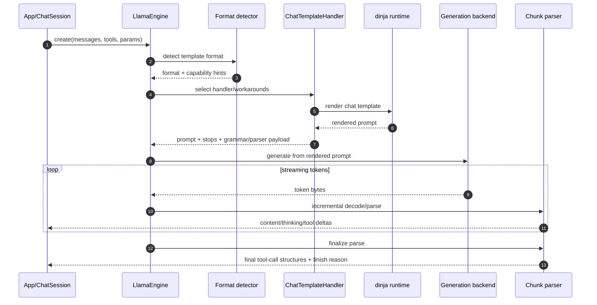

`llamadart` reimplements the `llama.cpp` chat-template/render/parse stack in
Dart so routing and parser behavior stay consistent across native and web
targets.

## Design goal

The template system prioritizes llama.cpp parity:

- format detection behavior
- handler routing logic
- tool-grammar attachment rules
- parse behavior for thinking and tool-call envelopes

## End-to-end pipeline

## Main components

### 1. Format detection

- `ChatTemplateEngine` detects format from template signatures.
- Each detected format maps to a concrete `ChatTemplateHandler`.
- Handlers live under `lib/src/core/template/handlers/`.

### 2. Template capabilities and routing

- `TemplateCaps` reports whether a template supports system role, tools,
  tool calls, parallel tool calls, string and typed content, object
  arguments, and thinking channels.
- `JinjaAnalyzer` detects all but thinking with llama.cpp's capability
  probes: it renders llama.cpp's probe conversations and records which values
  the template reads. Thinking support comes from the template's thinking
  markers.
- Every template gets the media marker in the message text where an image,
  audio or video part was, as llama.cpp renders it. A template's own
  placeholder for a typed image or audio part is not written.
- A request that carries media is rendered with a random marker, drawn once
  for the isolate, so a placeholder string that a message quotes (``,
  `<image>`, `[IMG]`, `<__media__>`) is not a part. `LlamaEngine.create`
  hands that prompt to a backend with `BackendChatPromptGeneration` (the
  llama.cpp and WebGPU backends) as a chat prompt. A prompt passed to
  `generate` is the caller's: its placeholders and `<__media__>` stand for
  the parts.
- mtmd and the WebGPU bridge find a part by a fixed string wherever it is,
  so a quoted string they would match reaches the model with a zero-width
  space (U+200B) after its first character: `<__media__>` on native, and
  the placeholders the bridge rewrites on Web.
- `chatTemplate` output for messages with media, and the prompt `create`
  gives a backend without `BackendChatPromptGeneration`, go through
  `generate`. They have `<__media__>` where each part was and the zero-width
  space in every other string `generate` reads as a part. Messages without
  media render as they are.
- A template that fails to render, by raising or through invalid syntax,
  throws `LlamaInferenceException` with the template's message. The message
  names the template: the model's `tokenizer.chat_template` or its
  `tool_use` variant, `ModelParams.chatTemplate`, or a per-call
  `customTemplate`. With no template or an empty `tokenizer.chat_template`,
  it names `the built-in ChatML fallback template`.
- Routing workarounds mirror llama.cpp behavior for schema mode, tool-choice
  behavior, and system-message adaptation.

### 3. Render stage

- Handler `render(...)` builds the final prompt and metadata payload.
- Result includes:
  - prompt text
  - stop sequences
  - optional grammar
  - optional PEG parser payload
  - preserved tokens and lazy grammar triggers
- Every template receives the resolved thinking flag as `enable_thinking`,
  as llama.cpp passes it; a handler's own context can still override it. When
  the prompt ends in a thinking start tag the handler did not track, the
  thought is forced open whatever the flag, as llama.cpp parses the open
  thought of a generation prompt as reasoning.
- A grammar that applies from the first token after a forced-open thought (a
  `responseFormat` schema, the generic tool grammar, or a required-call
  grammar) first takes the rest of the thought and its end tag, as
  llama.cpp's reasoning parser does.

### 4. Parse stage

- During streaming, partial output is parsed incrementally for content/thinking
  deltas and tool-call envelopes.
- On completion, final parse produces stable tool-call structures and finish
  reason semantics.
- PEG-backed parse paths are used when parser payloads are present.
  Parse failures name `peg-simple`, `peg-native`, or `peg-constructed`.
  `peg-constructed` is a historical llama.cpp name removed before b10549;
  llamadart retains it for the Qwen3 Coder XML mapper.
- A reply that a cancel or a generation limit cut short may not hold what
  the PEG parser requires, such as the tool call of `ToolChoice.required`.
  It is parsed as partial output instead: its content and thinking are kept,
  its tool calls are withheld, and it finishes with `length` at a limit and
  `stop` on a cancel, as with `ToolChoice.auto`. A limit counts only on a
  backend that reports a token limit, such as native llama.cpp; on one that
  does not, such as LiteRT-LM, a reply cut short by `maxTokens` is parsed as
  a complete one. A reply parsed as complete that does not parse throws
  `LlamaInferenceException`.
- This deliberately differs from upstream llama.cpp (`b10549`), whose server
  fails a cut-short `required` reply with a parse error. llamadart withholds
  the calls and finishes with `length` or `stop` instead
  ([#890](https://github.com/leehack/llamadart/issues/890)).
- When the template ends the prompt with an empty thought, as DeepSeek
  V3.1, Qwen3, QwQ and Qwen3.5 templates render with thinking off, the
  DeepSeek V3, Hermes and Qwen3-Coder XML parse and stream take the reply as
  content and tool calls, thinking tags included, as llama.cpp (`620d2225`)
  does. Other formats, and templates that leave the thought open, still
  parse thoughts; with thinking off, the stream drops that reasoning.
  StepFun3.5-Flash leaves it open even with thinking off: llamadart closes
  it in the prompt, but still parses a leading thought, as llama.cpp does
  with the open one.

## Tool-call parsing

Qwen XML tool calls are validated against the tools supplied to `engine.create`.
Schema-declared strings such as `"123"` retain their type. Unknown functions,
unknown or duplicate parameters, missing required values, and invalid value
types remain response content instead of producing callable tool deltas.
Tool calls are emitted after final validation; malformed output is preserved
through the existing rollback behavior. Direct schema-free template parsing
retains its legacy behavior, so pass tool definitions when validating calls.

Without a tool-call grammar, as with `ToolChoice.auto` on WebGPU, Qwen2.5 can
copy the double braces its GGUF template prints in the tool prompt:
`<tool_call>{{"name": "get_weather", "arguments": {"city": "Paris"}}}</tool_call>`,
sometimes with fewer or more closing braces. The Hermes/Qwen parser extracts
the call. When only closing braces and whitespace follow the call before
`</tool_call>`, the envelope leaves no content, as for the single-brace form;
otherwise its text stays in content. This deliberately differs from upstream
llama.cpp (`7fe450e1`), which fails to parse this output and returns no tool
call.

Streamed content and reasoning start and end with the whitespace the final
parse keeps, with or without tools, apart from the cases below. The parse
trims content, except that content at the end of the output keeps the
whitespace after it, as upstream llama.cpp (`d8123504`) does: `"Sure. \n"`
stays `"Sure. \n"`, also when a caller stop sequence cut the output there,
while whitespace before a thought or a tool call is dropped. So the stream
holds back leading whitespace until other text arrives, and trailing
whitespace until more text arrives or generation ends; a stream that ends
with an error does not deliver it. `ChatSession` and its tool loop deliver
that whitespace but store the assistant turn in `history` without it, so a
template that does not trim assistant content renders the next prompt as
before.
Other text waits only as described below, for example while it may be a
thinking tag or, with tools, a tool-call opening.

When tool calls are parsed, streamed content equals the content of the final
parse for Hermes, Mistral Nemo, Magistral, Qwen3-Coder XML, DeepSeek R1 and
V3, Command R7B, Cohere2 MoE, Granite, Nemotron V2, Apertus, MiniCPM5,
Hunyuan V3, EXAONE MoE, Seed-OSS, MiniMax M2, Apriel 1.5 and Xiaomi MiMo
output. Text from where the format's parse may find a tool-call opening,
and trailing whitespace, is held until later output rules the opening out or
generation ends, as llama.cpp (`7fe450e1`) PEG `until` stops content before a
whole delimiter or a partial one at the end of the input. With Qwen3-Coder
XML, a `<tool_call>` also ends a forced-open thought when the output has no
thinking tag, as its parse does. For these formats, with or without tools, a
start tag the model repeats at the start of a forced-open thought is dropped,
as in the parse, and when the output has no start tag, an end tag after the
first one is content. A later start tag makes the parse end a thought at each
earlier end tag; the stream does so only when that start tag arrives in the
same token as the end tag and as all the text since the previous end tag,
because text it has already streamed as content stays content. With
`Plan.</think>A` and then `</think>B<think>X</think>C`, the stream gives
content `ABC` where the parse gives `BC`.
Without tools, Command R7B and Cohere2 MoE content streams without the
`<|START_RESPONSE|>`, `<|START_TEXT|>` and matching end markers that wrap it,
as their parse drops them. These markers are control tokens in converted
GGUFs, which the chat template result preserves as llama.cpp does, so they
reach the parser instead of decoding as empty text.

DeepSeek V3 parses a forced-open thought as llama.cpp (`620d2225`) does: the
thought is the text before the first `</think>`, kept as generated, including
a repeated `<think>` and any escaped `\n`, and the rest is content, in which
thinking tags are text. Its stream does the same.

Streamed reasoning equals the parse too. The parse trims each thought;
upstream llama.cpp (`7fe450e1`) keeps the whitespace before `</think>`, so
with the Qwen3 template it returns `"Plan it.\n"` for
`<think>\nPlan it.\n</think>`. Except for Qwen3-Coder XML and a DeepSeek V3
forced-open thought, the parse also
replaces an escaped `\n` or `\r` in reasoning with a newline or a carriage
return; the Qwen3-Coder XML parse keeps them, as llama.cpp (`7fe450e1`) does
with the Qwen3.5 template. When tool calls are parsed, the stream of the
formats above replaces them too, holding back a trailing `\` until the next
token; otherwise it keeps them as generated. One exception is a forced-open
thought that never closes and starts with whitespace, with or without tools.
The parse keeps it untrimmed,
but the stream drops the leading whitespace before it can know the thought
will not close. The streamed text is then no prefix of the parse, so the final
reconciliation adds nothing and the trailing whitespace is lost too:
`"  \n Hello there.  \n\n"` streams as `"Hello there."`. The DeepSeek V3,
EXAONE MoE, Seed-OSS, MiniMax M2, Apriel 1.5 and Xiaomi MiMo parses return a
forced-open thought that never closes as reasoning, including any tool-call
envelope inside it, as llama.cpp (`620d2225c`) does with the MiniMax-M2 and
DeepSeek V3.1 templates.

Output parsed with a PEG parser (Ministral, Solar Open, Nemotron V3, or
Qwen3-Coder XML given a parser) streams the content and reasoning of partial
PEG parses when tool calls are parsed. Those parses hold back a possible
opening themselves. A Ministral thought cut off by the token limit therefore
streams as reasoning, although the final parse returns it, with its `[THINK]`
tag, as content. Without tools, the PEG parse does not trim leading
whitespace, so the stream keeps it.

Streams built from partial parses hold back trailing whitespace until more
text arrives. They are used for Gemma 4 output, and, when tool calls are
parsed, for PEG output, Kimi K3, MiniMax M1 and M3, DeepSeek V3.2 and V4,
Muse Glimmer, GLM 4.5 and Laguna output, and output of other formats not
listed above that starts with a forced-open thought or a tool call. A partial
parse taken before `</think>` arrives can stream leading whitespace of a
forced-open thought that the final parse trims.

## `dinja` integration

`llamadart` uses [`dinja`](https://pub.dev/packages/dinja), the Dart Jinja
runtime used as the execution layer for model-provided chat templates
(`tokenizer.chat_template`).

`dinja` was built in the `llamadart` ecosystem as a Dart port of the
llama.cpp-style minimal Jinja execution model, then used as the foundation of
the template engine in this package.

Inside `llamadart`, the `jinja/` integration layer acts as the Dinja-plugin
surface: it wires llama.cpp-specific globals and capability analysis into
template execution.

Why this matters:

- no Python runtime dependency in app environments
- on-device template rendering in pure Dart
- reusable lexer/parser access for capability analysis (`JinjaAnalyzer`)

In practice, our template integration stack is:

1. `dinja` template execution for render.
2. `llamadart` routing/parity logic around it.
3. `llamadart` parser/grammar infrastructure for streamed output.

## Practical debugging flow

1. Call `engine.chatTemplate(...)` to inspect prompt/format/stops.
2. Verify tool schema and grammar expectations before generation.
3. Compare parsed output in partial vs final streaming stages.
4. Re-test after model/runtime upgrades to catch routing shifts early.

## Related docs

- [Chat Templates and Parsing](./chat-template-and-parsing)
- [Tool Calling](./tool-calling)
- [Generation and Streaming](./generation-and-streaming)
