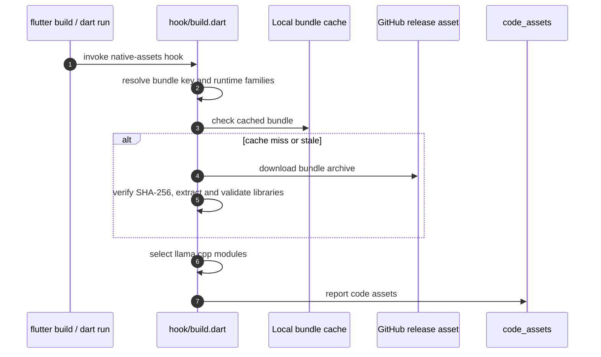

The `llamadart` build hook (`hook/build.dart`) downloads prebuilt llama.cpp and
LiteRT-LM runtimes for the target platform, so apps never compile C++. The hook
reports the downloaded `.so`, `.dylib` and `.dll` files as `package:code_assets`
code assets, and the Flutter or Dart build bundles them into the APK, IPA or
desktop app. On Linux and Windows, LiteRT-LM loads from the app bundle (beside
the executable, in its `lib/` directory, or in `../lib/` for a `dart build cli`
executable in `bin/`), and from the hook cache under `dart run` and
`dart test`; `LLAMADART_LITERT_LM_LIB_DIR` overrides both. On macOS, the hook
does not report LiteRT-LM libraries: they stay
in the hook cache inside the resolved `llamadart` package. `dart run` loads
them from there and a `dart build cli` bundle needs
`LLAMADART_LITERT_LM_LIB_DIR`. A Flutter macOS app gets them from the
`llamadart_litert_lm_flutter` companion instead
([Apple setup](./apple-setup#macos-litert-lm)); without it, the app needs the
[LiteRT-LM build phase](./apple-setup#flutter-macos-litert-lm-build-phase)
to copy them into the app bundle. Flutter iOS and macOS apps link runtimes
through SwiftPM companion packages: see [Apple setup](./apple-setup). To check a
setup before loading a model, see [Diagnose setup](./diagnose-setup).

Configure the hook under `hooks.user_defines.llamadart` in the app's
`pubspec.yaml`. Every key is optional:

| Key | Selects | Default |
| --- | --- | --- |
| `llamadart_native_runtimes` | Runtime families to bundle: `llama_cpp`, `litert_lm`, and the opt-in `stable_diffusion` | `llama_cpp` and `litert_lm` where published; `llama_cpp` only [alongside Flutter Edge AI](#alongside-flutter-edge-ai) |
| `llamadart_native_backends` | llama.cpp backend modules, and Android arm64 CPU variants | `cpu` and `vulkan` where present |
| `llamadart_stable_diffusion_backends` | The `stable_diffusion` build on Linux and Windows: `cpu` or `vulkan` | Follows `llamadart_native_backends` |
| `llamadart_native_tag` | `leehack/llamadart-native` release to download | The [pinned release](./support-matrix#pinned-runtimes) |
| `llamadart_native_repository` | GitHub repository to download llama.cpp bundles from | `leehack/llamadart-native` |
| `llamadart_native_path` | Local archive or bundle directory used instead of a download | Unset |

```yaml
hooks:
  user_defines:
    llamadart:
      llamadart_native_runtimes: [llama_cpp]
      llamadart_native_backends:
        platforms:
          android-arm64:
            backends: [vulkan]
            cpu_profile: compact
          linux-x64: [vulkan, cuda]
          windows-x64: [vulkan, cuda, blas]
```

After changing any of these keys, or after a native release tag is republished
with new assets, run `flutter clean` once so stale native assets are not
reused.

## Choose runtime families

`llamadart_native_runtimes` keeps whole runtimes out of the app when it ships
only one model format. The value is a list, or a map with a top-level
`runtimes` list and per-platform overrides under `platforms`:

```yaml
hooks:
  user_defines:
    llamadart:
      llamadart_native_runtimes:
        runtimes: [llama_cpp, litert_lm]
        platforms:
          ios: [llama_cpp]
          android-arm64: [litert_lm]
```

- Platform keys are OS names (`android`, `ios`, `linux`, `macos`, `windows`) or
  bundle keys: `android-arm64`, `android-x64`, `ios-arm64`, `ios-arm64-sim`,
  `ios-x86_64-sim`, `linux-arm64`, `linux-x64`, `macos-arm64`,
  `macos-x86_64`, `windows-arm64` and `windows-x64`. For each bundle the
  exact bundle key wins, then its OS key, then `runtimes`, then the default
  `llama_cpp` and `litert_lm`.
- Aliases: `gguf`, `llama`, `llama.cpp` for `llama_cpp`; `litert`,
  `litert-lm`, `litertlm`, `.litertlm` for `litert_lm`; `stable-diffusion` for
  `stable_diffusion`. `all` selects every family, the opt-in
  `stable_diffusion` included; `both` selects `llama_cpp` and `litert_lm`, the
  same as leaving the key unset. Unknown names are dropped with a warning.
- Selecting `litert_lm` by name for a target without a LiteRT-LM runtime, such
  as the iOS x86_64 simulator or Windows arm64, fails the build. When it is only
  implied by the default, `both` or `all`, the hook drops it with a warning.
- macOS x86_64 is the exception, because a universal build runs the hook for
  x86_64 too
  ([litert-lm-native#72](https://github.com/leehack/litert-lm-native/issues/72)).
  Only a `macos-x86_64` or `macos-x64` entry that names `litert_lm` fails the
  build. A `runtimes` or `macos` entry that names it gets a warning and no
  LiteRT-LM in the x86_64 slice. `[litert_lm]` alone leaves that slice with no
  native assets, and loading a `.litertlm` model there throws
  `LlamaUnsupportedException`. `LLAMADART_LITERT_LM_LIB_DIR` does not lift
  that error on x86_64; a `libraryPath` passed to `LiteRtLmRuntimeClient`
  does.
- An empty or all-unknown selection falls back to `llama_cpp` and
  `litert_lm`; one that leaves no runtime, such as `none`, fails the build.

### Alongside Flutter Edge AI

`flutter_edge_ai_litertlm` ships its own copy of the LiteRT-LM libraries
llamadart bundles, and `flutter_edge_ai_llama` uses only the llama.cpp
runtime. When the app depends on llamadart together with either package:

- An unset key, `both` and `all` leave `litert_lm` out, and the hook writes a
  `warning: llamadart:` line that names the package to the build's error
  output. `all` still bundles `stable_diffusion`. Flutter's `--fatal-warnings`
  fails a build that prints the line; `llamadart_native_runtimes: [llama_cpp]`
  selects the same runtimes without it.
- Naming `litert_lm` keeps it next to `flutter_edge_ai_llama`.
- Naming `litert_lm` next to `flutter_edge_ai_litertlm` fails the build before
  anything is downloaded. On iOS and macOS, depending on
  `llamadart_litert_lm_flutter` counts as naming it. Set
  `llamadart_native_runtimes: [llama_cpp]` and remove that companion.

The build does not tell the hook which app it is building, and every package
resolved into one `.dart_tool` shares the hook's output: one app, or all
members of a pub workspace. The hook therefore reads
`.dart_tool/package_graph.json` and applies the rules above when any root
package there reaches both llamadart and one of the two packages through its
dependencies. A root's `dev_dependencies` count, because `dart run`,
`dart test` and non-release Flutter builds bundle them. In a pub workspace:

- The build reads `hooks.user_defines` from the workspace root `pubspec.yaml`
  only, so set `llamadart_native_runtimes` there.
- One member that combines llamadart with such a package changes the default
  for every member. A member that loads `.litertlm` models through llamadart
  needs `litert_lm` named at the root, which fails while any member combines
  llamadart with `flutter_edge_ai_litertlm`; move one of the two out of the
  workspace.

If the hook cannot read the graph file it keeps the configured runtimes and
logs a warning. Web builds bundle no native runtime and are unaffected.

### Opt-in stable_diffusion runtime (experimental)

`stable_diffusion` bundles the
[stable-diffusion.cpp](https://github.com/leejet/stable-diffusion.cpp) runtime
from `leehack/stable-diffusion-native` for the experimental
[`ImageGenerationEngine`](../guides/image-generation). It adds about 40 to
70 MB per target, so it is never bundled by default or by `both`; name it, or
select `all`. Unset, `llamadart_native_runtimes` bundles `llama_cpp` and
`litert_lm`, or `llama_cpp` only
[alongside Flutter Edge AI](#alongside-flutter-edge-ai); a list replaces those
defaults, so it names every runtime the app loads:

| The app loads | `llamadart_native_runtimes` |
| --- | --- |
| GGUF and `.litertlm` models | unset |
| Images only | `[stable_diffusion]` |
| GGUF models and images | `[llama_cpp, stable_diffusion]` |
| Every runtime published for the target | `all` |

```yaml
hooks:
  user_defines:
    llamadart:
      llamadart_native_runtimes: all
```

- `all` only implies its runtimes, so a target without a LiteRT-LM or
  `stable_diffusion` build skips that runtime with a warning.
  `[llama_cpp, litert_lm, stable_diffusion]` names `litert_lm` and fails the
  build on a target without it, except macOS x86_64, which only warns unless a
  `macos-x86_64` or `macos-x64` entry names it.
- In a Flutter iOS or macOS app, `all` includes `stable_diffusion` only when
  the `llamadart_stable_diffusion_flutter` companion is a dependency. Without
  it the hook leaves the runtime out with a build warning that names the
  companion, and `ImageGenerationEngine.checkRuntime()` reports it as not
  bundled. `flutter build macos`, Xcode and `xcodebuild` show the warning;
  `flutter build ios` output does not. Naming `stable_diffusion` still bundles
  it through the hook there. A pub workspace follows the app member described
  under [Apple setup](./apple-setup#pub-workspaces-and-host-tests).
- Published for `android-arm64`, `ios-arm64`, `ios-arm64-sim`,
  `ios-x86_64-sim`, `macos-arm64`, `macos-x86_64`, `linux-arm64`, `linux-x64`
  and `windows-x64`, built for iOS
  16.4 and macOS 13.3 or newer. At run time the engine checks the CPU before
  loading the library: Android needs an Armv8.2 CPU with dot-product and fp16
  (`asimddp`, `fphp`, `asimdhp`), and Linux and Windows x64 need AVX2, FMA,
  F16C and BMI2. Otherwise `ImageGenerationEngine.load` throws
  `LlamaUnsupportedException` instead of crashing on an illegal
  instruction. On Windows the runtime also needs the latest Microsoft Visual
  C++ v14 Redistributable (x64); stock Windows Server lacks it, and the
  error names the DLL that failed to load.
- Apple builds use the Metal build and Android the CPU build. Linux and Windows
  publish a CPU build (about 38 MB) and a Vulkan build (about 72 MB) that needs
  the system Vulkan loader (`libvulkan.so.1` or `vulkan-1.dll`) at run time.
  `llamadart_stable_diffusion_backends` picks one, as a list for every
  platform or a `platforms` map like `llamadart_native_backends`:

  ```yaml
  hooks:
    user_defines:
      llamadart:
        llamadart_stable_diffusion_backends: [cpu]
        # or per platform:
        # llamadart_stable_diffusion_backends:
        #   platforms:
        #     linux: [vulkan]
        #     windows: [cpu]
  ```

  It accepts `cpu` and `vulkan` (alias `vk`) and leaves the llama.cpp
  backends unchanged. A list naming `vulkan` selects the Vulkan build even
  when it also names `cpu`. Without an entry for the platform, or with an
  empty one, the build follows `llamadart_native_backends` for the same
  platform: Vulkan when Vulkan is selected there, which is the default, and
  CPU otherwise. A value naming neither `cpu` nor `vulkan` is ignored with a
  build warning and the same fallback applies.
- Other targets, such as `android-x64` or Windows arm64, are skipped with a
  warning. Naming it for that exact bundle key, for example
  `android-x64: [stable_diffusion]`, fails the build instead.
- Flutter iOS and macOS apps should add the `llamadart_stable_diffusion_flutter`
  companion instead; see [Apple setup](./apple-setup#companion-packages). Without it
  a list naming `stable_diffusion` makes the hook bundle the runtime, and App
  Store Connect rejects that iOS framework: Flutter writes `MinimumOSVersion`
  13.0 into it, while the library needs iOS 16.4. The hook reports this as an
  Xcode build warning, which Xcode and `xcodebuild` show but plain
  `flutter build` and `flutter run` output does not.

## Choose llama.cpp backend modules

`llamadart_native_backends` filters the split llama.cpp modules inside the
`llama_cpp` family; it does not affect LiteRT-LM. It is set per platform,
under `platforms` or as a map keyed by platform. A platform value is a list, a
comma-separated string, or a map with a `backends` list. A bare top-level list
applies to no platform.

Modules in the pinned bundles:

| Bundle | Modules |
| --- | --- |
| `android-arm64`, `android-x64` | `cpu`, `vulkan`, `opencl` |
| `linux-arm64` | `cpu`, `vulkan`, `blas` |
| `linux-x64` | `cpu`, `vulkan`, `blas`, `cuda`, `hip` |
| `windows-arm64` | `cpu`, `vulkan`, `blas` |
| `windows-x64` | `cpu`, `vulkan`, `blas`, `cuda` |
| `ios-*`, `macos-*` | One consolidated CPU and Metal runtime; not configurable |

Aliases: `vk` for `vulkan`; `ocl` and `open-cl` for `opencl`.
`GpuBackend.metal` still selects Metal at runtime on Apple targets.

Selection rules:

- With no request, the hook bundles `cpu` and `vulkan`, where present.
- `cpu` is always added when the bundle has it.
- A request that names any module the bundle lacks is rejected whole: the hook
  warns and uses the defaults. If the defaults are missing too, it bundles every
  module.
- CUDA runtime DLLs (`cudart64_*`, `cublas64_*`, `cublaslt64_*`) ship only with
  `cuda`, and OpenBLAS libraries only with `blas`.
- Modules are selected after download. A `windows-x64` release with hook
  contract 2 publishes `ggml-cuda.dll` and its CUDA runtime DLLs as a separate
  `llamadart-native-windows-x64-cuda12-<tag>.tar.gz`, which the hook downloads
  and verifies only when `cuda` is selected for `windows-x64`. If such a
  release lists no CUDA archive, selecting `cuda` fails the build with
  `NativeHookContractException` instead of falling back. The pinned
  `v0.8.0` is a contract 2 release: its `windows-x64` archive is about
  15 MiB, and the CUDA archive adds about 688 MiB. Contract 1 releases ship
  CUDA inside a `windows-x64` archive of about 700 MiB, which the hook
  downloads even when `cuda` is not selected.
  Archives are cached under the llamadart package's
  `.dart_tool/llamadart/native_bundles/`. To skip the download, set
  `llamadart_native_path` to a local archive or bundle.
- On `windows-x64`, the hook rejects a bundle whose `cuda` module lacks the
  cudart and cuBLAS DLLs, or whose `blas` module lacks OpenBLAS.

Linux modules need system libraries; see
[Linux prerequisites](./linux-prerequisites).

On Windows the bundles ship the Visual C++ runtime app-locally
(`msvcp140.dll` and `vcruntime140.dll`, plus `vcruntime140_1.dll` and the
OpenMP runtime `vcomp140.dll` on x64), so no Visual C++ Redistributable is
needed. The LiteRT-LM Windows x64 runtime ships `msvcp140.dll`,
`vcruntime140.dll`, `vcruntime140_1.dll` and `vcruntime140_threads.dll`, but no
`vcomp140.dll`; when an app bundles both runtimes, the hook
bundles the newer file version of each DLL they share. `vulkan` also needs a GPU driver that
provides the Vulkan loader, `vulkan-1.dll`, and `cuda` an NVIDIA driver,
which provides `nvcuda.dll`. When one of those is missing, the module's
startup diagnostic, which a failed model load reports, names it.

### When a requested backend is not bundled

`ModelParams.preferredBackend` selects only a module the app has. With the
default `cpu` and `vulkan`, `GpuBackend.cuda` has no module to load, so on
Linux and Windows the model loads on CPU with 0 GPU layers rather than on
another GPU backend. llamadart logs a `LlamaLogLevel.warn` record through the
Dart logger that names the backend and this user-define, and
`getBackendName()` reports `CPU`. To use CUDA, add it for the platform:

```yaml
hooks:
  user_defines:
    llamadart:
      llamadart_native_backends:
        platforms:
          linux-x64: [cpu, vulkan, cuda]
          windows-x64: [cpu, vulkan, cuda]
```

- On Windows, `dart run` and `dart test` load only the modules the app
  bundles, as does a Linux app built with `dart build cli` and run from
  another directory.
- On Linux, a process whose working directory is the package root, as with
  `dart run` and `dart test`, copies each backend module missing from
  `.dart_tool/lib` out of the hook's download cache,
  `.dart_tool/llamadart/native_bundles/<tag>/linux-<arch>/extracted`, when the
  backend starts. The cache holds every module in the release, `cuda` and
  `hip` included on x64, so there CUDA loads without the user-define when its
  [system libraries](./linux-prerequisites) are installed.

When the module is bundled but cannot be used, because it fails to load (for
example `ggml-cuda.dll` without an NVIDIA driver) or finds no device, and no
other GPU is registered, the model also loads on CPU with 0 GPU layers.
`getResolvedGpuLayers()` returns 0, llamadart logs a warning, and
`getAvailableBackends()` stops listing a backend whose module failed to load.
Under `GpuBackend.auto`, `getResolvedGpuLayers()` also returns 0 when no GPU
device is registered, without a warning, since no backend was requested.

### Android arm64 CPU variants

The `android-arm64` map form also takes `cpu_profile` and `cpu_variants`:

- `cpu_profile: full` (default) bundles all seven CPU variant modules.
- `cpu_profile: compact` bundles only the baseline `android_armv8.0_1`.
- `cpu_variants: [...]` lists variants explicitly and overrides `cpu_profile`.
  Unknown entries are dropped with a warning; if none remain, `cpu_profile`
  applies.

| Variant | Optional CPU features |
| --- | --- |
| `android_armv8.0_1` | Baseline |
| `android_armv8.2_1` | `DOTPROD` |
| `android_armv8.2_2` | `DOTPROD`, `FP16_VECTOR_ARITHMETIC` |
| `android_armv8.6_1` | `DOTPROD`, `FP16_VECTOR_ARITHMETIC`, `MATMUL_INT8` |
| `android_armv9.0_1` | `DOTPROD`, `FP16_VECTOR_ARITHMETIC`, `MATMUL_INT8`, `SVE2` |
| `android_armv9.2_1` | `DOTPROD`, `FP16_VECTOR_ARITHMETIC`, `MATMUL_INT8`, `SVE`, `SME` |
| `android_armv9.2_2` | `DOTPROD`, `FP16_VECTOR_ARITHMETIC`, `MATMUL_INT8`, `SVE`, `SVE2`, `SME` |

Variant names are normalized, so `baseline`, `armv8_6_1`, `v9_0_1`,
`android-armv9.2_2` and `libggml-cpu-android_armv8.2_2.so` are all accepted.

### Linux arm64 CPU variants

A `linux-arm64` bundle may ship `libggml-cpu-linux_armv8.6_1.so`
(`DOTPROD`, `FP16_VECTOR_ARITHMETIC`, `MATMUL_INT8`) and
`libggml-cpu-linux_armv8.2_2.so` (`DOTPROD`, `FP16_VECTOR_ARITHMETIC`) beside
the baseline `libggml-cpu.so`. The hook bundles all of them, and every backend
mode loads the highest variant the CPU supports, falling back to the baseline.

## Override the llama.cpp release

```yaml
hooks:
  user_defines:
    llamadart:
      llamadart_native_tag: vX.Y.Z
      llamadart_native_repository: leehack/llamadart-native
      # llamadart_native_path: ./native-bundles
```

- `llamadart_native_tag` names a `llamadart-native` release tag, not a
  `llamadart` package version. The hook accepts `vMAJOR.MINOR.PATCH`,
  `vMAJOR.MINOR.PATCH-N`, `bNNNN`, `bNNNN-N` and `bNNNN-llamadart.N`.
  Build-hook overrides must always name an explicit tag; `latest` is limited
  to maintainer synchronization and header/binding regeneration. Nightly
  cores are written without leading zeros, and rebuild counters start at 1.
  List releases with
  `gh release list --repo leehack/llamadart-native --limit 20`.
- The release must contain `llamadart-native-<bundle>-<tag>.tar.gz` for the
  target and a `SHA256SUMS` that lists it; otherwise the build fails before
  using the archive. The pinned release is verified against digests in
  `lib/src/hook/native_release_pins.dart` instead.
- Before downloading from an overridden release, the hook reads its
  `assets.json` and fails with `NativeHookContractException` when it needs a
  hook contract other than 1 or 2. A release without `assets.json` counts as
  contract 1.
- The hook keeps the release's `SHA256SUMS` beside the cached archive under
  the llamadart package's `.dart_tool/llamadart/native_bundles/`. A cached archive that it lists is
  used without network access; any download is checked against a freshly
  fetched `SHA256SUMS`. To build an override offline, pre-seed both files in
  the directory the error names (`SHA256SUMS` as UTF-8 or ASCII text), or use
  `llamadart_native_path`. A `cuda` build of a contract 2 release also needs
  the release's `assets.json` and its CUDA archive, which the hook caches the
  same way. A release that publishes no `assets.json` is recorded as
  `assets.json.absent` in the directory above the bundle directories, beside
  `assets.json`, and re-checked once the record is a day old or dated in the
  future; a re-check that fails, or returns a page that does not start as JSON
  such as a network block page, keeps and renews the record. An empty,
  truncated or non-UTF-8 body, and JSON that is not a manifest (such as
  `{"error":"blocked"}` or `[]`), fails the build instead. Delete the file to
  re-check sooner. When `assets.json` is neither
  cached nor reachable, a build over a cached core uses a CUDA sidecar cached
  under the pinned release's archive name (`windows-x64-cuda12`), and
  otherwise warns and leaves out the backends that core lacks. A cached
  archive that matches its digest but lacks runtime libraries fails the build
  instead of being downloaded again.
- `llamadart_native_repository` takes an `owner/repo` slug or a
  `https://github.com/owner/repo` URL.
- `llamadart_native_path` wins over downloads. It can point at an archive, an
  extracted bundle directory, or a directory containing `<tag>/<bundle>/`,
  `<bundle>/`, or the expected archive. Relative paths resolve from the
  `pubspec.yaml` that sets them. Local bundles are trusted as given; the hook
  does not check their digests. A local `windows-x64` bundle of a contract 2
  release ships CUDA only when the `windows-x64-cuda12` archive is extracted
  into the same directory.

Overrides do not regenerate the Dart FFI bindings, so the binary must stay ABI-
and symbol-compatible with the pinned release; the hook logs a warning when an
override is active. This core requires the v0.7.0 ABI, including its changed
context-parameter and performance-data layouts; it calls nothing that
`v0.7.0-3` lacks. Native v0.6.0 and older
bundles are incompatible even when they export the same symbol names. Use
core `0.13.x` for its v0.6.0 runtime and companions. Do not point a core before
`0.17.1` at native `v0.8.0` or later: its bindings give
`mtmd_helper_init_opt` 24 bytes, and `v0.8.0` writes past them.

State files are tied to the llama.cpp release of the runtime that wrote them
([Save and restore prompt state](../guides/model-lifecycle#save-and-restore-prompt-state)).
One check fails closed:

- LoRA adapters need both `llama_adapter_get_alora_n_invocation_tokens` and
  `llama_adapter_get_alora_invocation_tokens`. Without a compatible pair,
  `setLoraSource` and loads with `ModelParams.loras` throw
  `LlamaUnsupportedException` rather than activate an adapter whose type it
  cannot check.

LiteRT-LM has no override keys; the hook always downloads the pinned
`litert-lm-native` release and verifies its checksum. Tag grammar for
maintainers: [Native and web sync](../maintainers/native-and-web-sync).

## How the hook resolves a build



Runtime sources: llama.cpp bundles come from
[`leehack/llamadart-native`](https://github.com/leehack/llamadart-native) and
LiteRT-LM bundles from
[`leehack/litert-lm-native`](https://github.com/leehack/litert-lm-native).
The hook checks every downloaded or cached llama.cpp, LiteRT-LM and
stable-diffusion.cpp archive against its SHA-256 before extracting it, and
downloads it again when a cached copy does not match; a fresh download that
does not match fails the build with `NativeArchiveDigestException`. Beside
each llama.cpp bundle's `extracted/` directory the hook writes `extracted.json`,
recording the archive's SHA-256, size and modification time and every extracted
file's size. A later build reuses `extracted/` only while that record matches
the cached archive and the directory's files, hashing the archive again only
when its modification time changed; otherwise it extracts the cached archive
again, verified as above, or downloads it when the archive is gone.
The hook also checks each LiteRT-LM archive for its required libraries and
downloads it again when a cached copy is incomplete. Which
repository owns which change: [Runtime ownership](../maintainers/runtime-ownership).
